 

## 👨‍💻 &nbsp;Sobre mim

Sou estudante de **Análise e Desenvolvimento de Sistemas** na UNINASSAU e sou um desenvolvedor backend. Estou aprendendo **Python** e **FastAPI** criando projetos práticos, e busco minha primeira oportunidade na área.

## 🚀 &nbsp;Projeto em destaque

### [FastAPI — API REST](https://github.com/eduardolopes79/fastapi)

*API construída com **Python**, **FastAPI** e **SQLAlchemy**, para praticar o ciclo completo de um backend: rotas, validação, persistência e deploy.*

  

| Etapa | Descrição | Situação |
|:---:|---|:---:|
| 🧱 | Estrutura inicial com FastAPI | ✅ |
| 🔁 | Rotas CRUD (criar, listar, atualizar, remover) | 🔄 |
| 🛡️ | Validação de dados com Pydantic | 🔄 |
| 🗃️ | SQLAlchemy | 🔄 |
| 🐳 | Containerização com Docker | 📅 |
| ☁️ | Deploy no Fly.io | 📅 |

## 🛠️ &nbsp;Stack e ferramentas

  

| Categoria | Tecnologias |
|:---:|:---|
| **Backend** | Python · FastAPI |
| **Banco de dados** | PostgreSQL · SQLAlchemy |
| **Front-end (básico)** | HTML · CSS |
| **Ferramentas** | Git · GitHub |
| **Aprendendo agora** | Docker · Fly.io |

## 📊 &nbsp;Estatísticas do GitHub

## 🤝 &nbsp;Vamos conversar?

Aberto a **networking**, **troca de conhecimento** e **oportunidades de estágio ou júnior** em backend.

 

  

⭐ *Gostou de algum projeto? Deixa uma estrela no repositório!* ⭐

